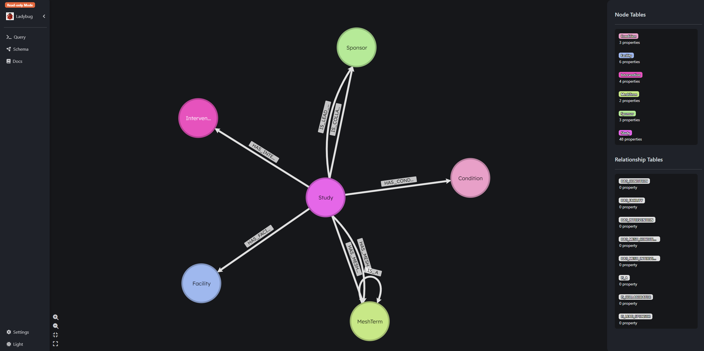
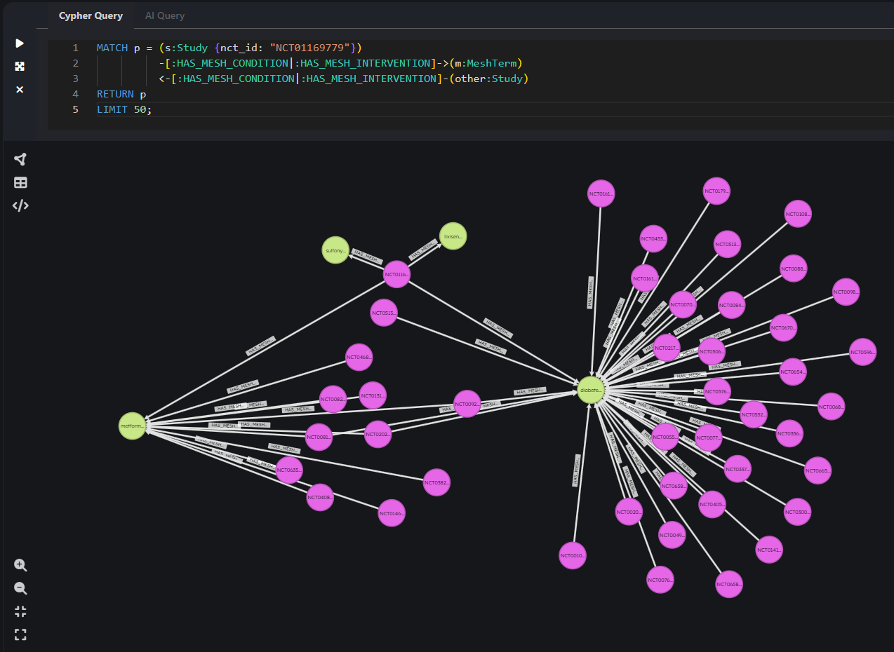
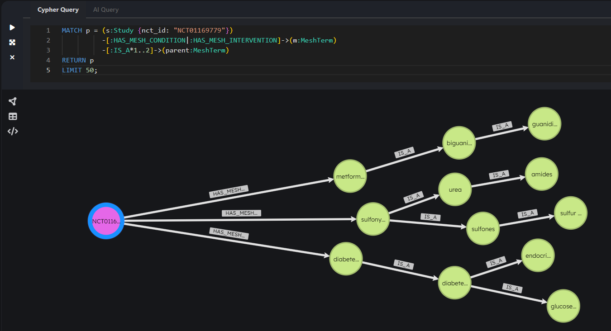
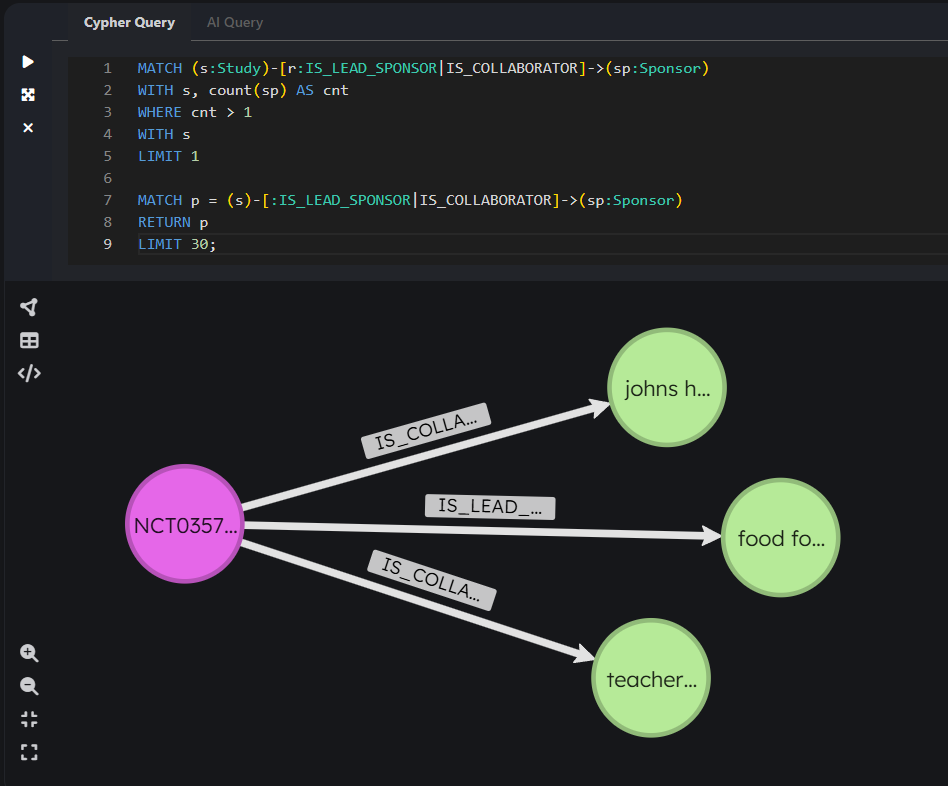

# ClinicalTrials.gov Datamine

## About
#### This repository contains Dockerfiles and pipeline scripts which connect with a containerized SQL database dump of the ClinicalTrials.gov relational database from [AACT](https://aact.ctti-clinicaltrials.org/downloads) and creates a graph database schema of nodes and edges from select tables for all clinical trials on the primary key nct_id and creates a Kuzu database viewable with Ladybug Explorer

## Inital Setup/Installation
Docker images and scripts in this pipeline are designed to be portable, and tested on Windows Subsystem for Linux (WSL2) running Ubuntu 24.04 with Docker Desktop integration.

### WSL2
The most straightforward way to install WSL2 Ubuntu on Windows 10+ is through the official Microsoft Software store
https://apps.microsoft.com/detail/9pdxgncfsczv?hl=en-US&gl=US 

### Docker Desktop
Install from https://www.docker.com/products/docker-desktop/

Docker Desktop integrates seamlessly with WSL2:

Settings -> Resources -> WSL Integration tab -> ✅ "Enable integration with my default WSL distro"

### DBeaver
Install from https://dbeaver.io/download/ for Windows, it can be used to view the AACT SQL Database running within the Docker container 

## 1. Create local AACT ClinicalTrials Database (ONLY DONE ONCE)
### 1.1. Download the ClinicalTrials.gov Database .ZIP file: 
https://aact.ctti-clinicaltrials.org/static/static_db_copies/daily/2026-04-08?source=web

Unzip the .ZIP file to a location inside this repo

### 1.2 Docker Compose
Once Docker is installed and integrated to WSL2, open the Ubuntu terminal on Windows and clone this repository to your folder of choice (preferably /home/username)
```
git clone https://github.com/jun137-dce/aact-datamine.git
```

#### Naviage to datamine/ladybug-stack in the Ubuntu terminal and run `docker compose` 
```
cd datamine/ladybug-stack
docker compose up -d
```
If compose is successful you will see 3 Docker containers in Docker Desktop:


### 1.3 Import AACT Database to Container
#### Navigate in your terminal to where you extracted the .ZIP AACT database file and run
```
docker exec -i aact-postgres pg_restore \
  -U postgres \
  -d aactdb \
  --no-owner \
  --role=postgres \
  < postgres.dmp
```
Note that the `pg_restore` command can take over an hour to complete but only needs to be done once

## 2. Translate SQL to Nodes and Edges with `run_aact_pipeline.py` 

The first half of this stack connects to the PostgreSQL AACT database and traverses the schema to grab Sponsors, Facilites, Conditions, Interventions and MeSH Terms for all clinical trials (NCT_IDs)

### 2.1 Build environment Docker Image
```
cd datamine/aact-pipeline
docker build -t aact_pipeline . --no-cache
```

### 2.2 Run AACT SQL data to Graph pipeline
```
docker run --rm \
  --user $(id -u):$(id -g) \
  -e DB_HOST=host.docker.internal \
  -e DB_NAME=aactdb \
  -e DB_USER=postgres \
  -e DB_PASS=postgres \
  -e MESH_CACHE_PATH=/app/data/mesh_hierarchy.json \
  -v "$(pwd)/output:/app/output" \
  -v "$(pwd)/data:/app/data" \
  aact_pipeline
```
#### A successful run will output:
```
Loading MeSH browse tables from AACT...
Building MeshTerm nodes...
  22531 unique MeSH terms
Building study → MeSH edges...
  809226 condition edges, 460608 intervention edges
Building disease area features (multi-hot from ancestor terms)...
  429400 studies × 24 disease areas
Loading MeSH hierarchy (download once, then cached)...
Building IS_A hierarchy edges...
  18880 IS_A edges
MeSH build complete.
  merged 24 disease area columns into study_features.parquet
Encoding node features...
  saved study_features_encoded.parquet  (579010 rows × 83 cols)
  saved facilities_encoded.parquet  (78242 rows × 229 cols)
  saved interventions_encoded.parquet  (960553 rows × 12 cols)
  saved sponsors_encoded.parquet  (101278 rows × 10 cols)
  saved conditions_encoded.parquet  (1031958 rows × 2 cols)
Encoding complete.
✅ Pipeline complete. Outputs written to /app/output
```

## 3. Import Nodes and Edges into Kuzu Explorer with `ladybug_import.py`

### 3.1 Build environment Docker Image
```
cd datamine/ladybug-stack
docker compose build graph-pipeline
```

### 3.2 Import Graph Node and Edges into .kz database file
```
docker compose run --rm graph-pipeline python ladybug_import.py
```
#### A successful run will output:
```
✔ Container aact-postgres Running
Container ladybug-stack-graph-pipeline-run-46103dda4c4c Creating
Container ladybug-stack-graph-pipeline-run-46103dda4c4c Created
Opening Kuzu DB at /database/database.kz ...

Setting up schema...
  node table ready: Study
  node table ready: Condition
  node table ready: Intervention
  node table ready: Sponsor
  node table ready: Facility
  node table ready: MeshTerm
  rel table ready: HAS_CONDITION
  rel table ready: HAS_INTERVENTION
  rel table ready: IS_LEAD_SPONSOR
  rel table ready: IS_COLLABORATOR
  rel table ready: HAS_FACILITY
  rel table ready: HAS_MESH_CONDITION
  rel table ready: HAS_MESH_INTERVENTION
  rel table ready: IS_A

Importing nodes...
  Study: 579010 rows
  Condition: 1031958 rows
  Intervention: 960553 rows
  Sponsor: 101278 rows
  Facility: 78242 rows
  MeshTerm: 22531 rows

Importing edges...
  HAS_CONDITION: 1031958 rows
  HAS_INTERVENTION: 960553 rows
  IS_LEAD_SPONSOR: 579009 rows
  IS_COLLABORATOR: 346015 rows
  HAS_FACILITY: 2723515 rows
  HAS_MESH_CONDITION: 809226 rows
  HAS_MESH_INTERVENTION: 460608 rows
  IS_A: 18880 rows

Done. Data loaded into Kuzu database.

```
#### NOTE: Prior `.kz` database files need to be deleted if you ever re-run `ladybug_import.py`
```
docker stop kuzu-explorer
docker run --rm -v ladybug-stack_graph_data:/data alpine sh -c "rm -rf /data/*"
```
## 4. View Graph Database in Kuzu Explorer
### 4.1 Start the kuzu-explorer container in Docker Desktop


### 4.2 Navigate to Kuzu Explorer @ [localhost:8000](http://localhost:8000/)
#### You will see the graph schema:


### 4.3 Try some test Cypher queries to grab nodes and edges

#### Query one Diabetes type II study and neighbors with MeSHTerms
```
MATCH p = (s:Study {nct_id: "NCT01169779"})
          -[:HAS_MESH_CONDITION|:HAS_MESH_INTERVENTION]->(m:MeshTerm)
          <-[:HAS_MESH_CONDITION|:HAS_MESH_INTERVENTION]-(other:Study)
RETURN p
LIMIT 50;
```


#### MeSH terms for diabetes study
```
MATCH p = (s:Study {nct_id: "NCT01169779"})
          -[:HAS_MESH_CONDITION|:HAS_MESH_INTERVENTION]->(m:MeshTerm)
          -[:IS_A*1..2]->(parent:MeshTerm)
RETURN p
LIMIT 50;
```


#### Edge relationship in study with a lead sponsor and a collaborator
```
MATCH p = (s:Study)-[:IS_LEAD_SPONSOR|:IS_COLLABORATOR]->(sp:Sponsor)
WHERE s IN (
  MATCH (s2:Study)-[:IS_LEAD_SPONSOR|:IS_COLLABORATOR]->(:Sponsor)
  WITH s2, count(*) AS cnt
  WHERE cnt > 1
  RETURN s2
  LIMIT 1
)
RETURN p
LIMIT 30;
```


#### Cancer studies in Los Angeles
```
MATCH p = (s:Study)-[:HAS_MESH_CONDITION|HAS_MESH_INTERVENTION]->(m:MeshTerm),
          (s)-[:HAS_FACILITY]->(f:Facility)
WHERE toLower(m.name) CONTAINS "cancer"
  AND toLower(f.city) = "los angeles"
RETURN p
LIMIT 50;
```


### Acknowledgements
Aggregate Analysis of ClinicalTrials.gov (AACT) Database. Clinical Trials Transformation Initiative (CTTI). Available at: https://aact.ctti-clinicaltrials.org/ (Accessed: 4/8/2026).