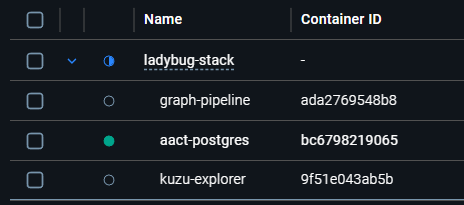
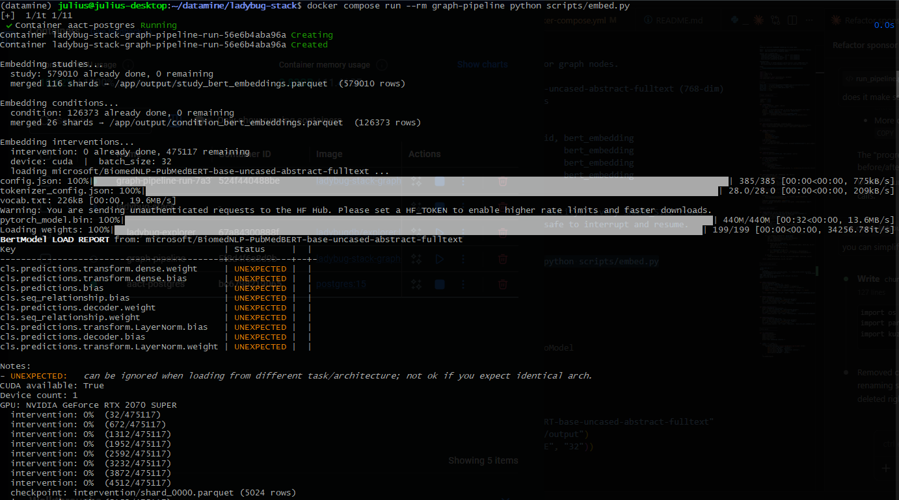
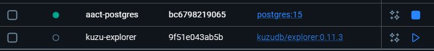

# ClinicalTrials.gov Datamine

## About
#### This repository contains Dockerfiles and pipeline scripts which connect with a containerized SQL database dump of the ClinicalTrials.gov relational database from [AACT](https://aact.ctti-clinicaltrials.org/downloads) and creates a graph database schema of nodes and edges from select tables for all clinical trials on the primary key nct_id and creates a Ladybug database viewable with Ladybug Explorer

## Inital Setup/Installation
Docker images and scripts in this pipeline are designed to be portable, and tested on Windows Subsystem for Linux (WSL2) running Ubuntu 24.04 with Docker Desktop integration.

### WSL2
The most straightforward way to install WSL2 Ubuntu on Windows 10+ is through the official Microsoft Software store
https://apps.microsoft.com/detail/9pdxgncfsczv?hl=en-US&gl=US 

### Docker Desktop
Install from https://www.docker.com/products/docker-desktop/

Docker Desktop integrates seamlessly with WSL2:

Settings -> Resources -> WSL Integration tab -> ✅ "Enable integration with my default WSL distro"

### DBeaver
Install from https://dbeaver.io/download/ for Windows, it can be used to view the AACT SQL Database running within the Docker container 

## 1. Create local AACT ClinicalTrials Database (ONLY DONE ONCE)
### 1.1. Download the ClinicalTrials.gov Database .ZIP file: 
https://aact.ctti-clinicaltrials.org/
###### * Original link aact.ctti-clinicaltrials.org/static/static_db_copies/daily/2026-04-08?source=web

Unzip the .ZIP file to a location inside this repo

### 1.2 Docker Compose
Once Docker is installed and integrated to WSL2, open the Ubuntu terminal on Windows and clone this repository to your folder of choice (preferably /home/username)
```
git clone https://github.com/jun137-dce/aact-datamine.git
```

#### Naviage to datamine/ladybug-stack in the Ubuntu terminal and run `docker compose` 
```
cd datamine/ladybug-stack
docker compose up -d
```
If compose is successful you will see 3 Docker containers in Docker Desktop:


### 1.3 Import AACT Database to Container
#### Navigate in your terminal to where you extracted the .ZIP AACT database file and run
```
docker exec -i aact-postgres pg_restore \
  -U postgres \
  -d aactdb \
  --no-owner \
  --role=postgres \
  < postgres.dmp
```
Note that the `pg_restore` command can take over an hour to complete but only needs to be done once

## 2. Translate SQL to Nodes and Edges with `run_aact_pipeline.py` 

The first half of this stack connects to the PostgreSQL AACT database and traverses the schema to grab Sponsors, Facilities, Conditions, Interventions, MeSH Terms, TrialArms, and WithdrawalEntries for all clinical trials (NCT_IDs)

### 2.1 Build environment Docker Image
```
cd datamine/aact-pipeline
docker build -t aact_pipeline . --no-cache
```

### 2.2 Run AACT SQL data to Graph pipeline
```
docker run --rm \
  --user $(id -u):$(id -g) \
  -e DB_HOST=host.docker.internal \
  -e DB_NAME=aactdb \
  -e DB_USER=postgres \
  -e DB_PASS=postgres \
  -e MESH_CACHE_PATH=/app/data/mesh_hierarchy.json \
  -v "$(pwd)/output:/app/output" \
  -v "$(pwd)/data:/app/data" \
  aact_pipeline
```
#### A successful run will output:
```
Loading MeSH browse tables from AACT...
Building MeshTerm nodes...
  22531 unique MeSH terms
Building study → MeSH edges...
  809226 condition edges, 460608 intervention edges
Building disease area features (multi-hot from ancestor terms)...
  429400 studies × 25 disease areas
Loading MeSH hierarchy (download once, then cached)...
Building IS_A hierarchy edges...
  18880 IS_A edges
MeSH build complete.
  merged 25 disease area columns into study_features.parquet
Building TrialArm nodes...
  188485 TrialArm nodes → /app/output/trial_arms.parquet
Building HAS_ARM edges...
  188485 HAS_ARM edges → /app/output/trial_arm_edges.parquet
Building withdrawal reason lookup (period × reason × bucket)...
  580,821 rows, 28420 distinct reason strings → /app/output/withdrawal_reason_lookup.parquet
  580,821 HAS_WITHDRAWAL_ENTRY edges → /app/output/withdrawal_entry_edges.parquet
Computing study-level withdrawal features...
  77316 studies with withdrawal data
  merged 12 withdrawal columns into study_features.parquet
Encoding node features...
  saved study_features_encoded.parquet  (579010 rows × 96 cols)
  saved facilities_encoded.parquet  (78242 rows × 229 cols)
  saved interventions_encoded.parquet  (475117 rows × 12 cols)
  saved sponsors_encoded.parquet  (101278 rows × 10 cols)
  saved conditions_encoded.parquet  (126373 rows × 2 cols)
Encoding complete.
✅ Pipeline complete. Outputs written to /app/output
```

## 3. Import Nodes and Edges into Ladybug Explorer with `ladybug_import.py`

### 3.1 Build environment Docker Image
```
cd datamine/ladybug-stack
docker compose build graph-pipeline
```

### 3.2 Add PubMedBERT embeddings to Study, Condition, Intervention and MeSHTerm
```
docker compose run --rm graph-pipeline python scripts/embed.py
```
#### A successful run will output:



### 3.3 Import Graph Node and Edges into .kz database file
```
docker compose run --rm graph-pipeline python ladybug_import.py
```
#### A successful run will output:
```
Opening Ladybug DB at /database/database.kz ...

Setting up schema...
  node table ready: Study
  node table ready: Condition
  node table ready: Intervention
  node table ready: Sponsor
  node table ready: Facility
  node table ready: MeshTerm
  node table ready: TrialArm
  node table ready: WithdrawalEntry
  rel table ready: HAS_CONDITION
  rel table ready: HAS_INTERVENTION
  rel table ready: IS_LEAD_SPONSOR
  rel table ready: IS_COLLABORATOR
  rel table ready: HAS_FACILITY
  rel table ready: HAS_MESH_CONDITION
  rel table ready: HAS_MESH_INTERVENTION
  rel table ready: IS_A
  rel table ready: MAPS_TO_MESH_CONDITION
  rel table ready: MAPS_TO_MESH_INTERVENTION
  rel table ready: HAS_ARM
  rel table ready: HAS_WITHDRAWAL_ENTRY

Importing nodes...
  Study: 579010 rows
  Condition: 126373 rows
  Intervention: 475117 rows
  Sponsor: 101278 rows
  Facility: 78242 rows
  MeshTerm: 22531 rows
  TrialArm: 188485 rows
  WithdrawalEntry: 580821 rows

Importing edges...
  HAS_CONDITION: 126373 rows
  HAS_INTERVENTION: 475117 rows
  IS_LEAD_SPONSOR: 579009 rows
  IS_COLLABORATOR: 346015 rows
  HAS_FACILITY: 2723515 rows
  HAS_MESH_CONDITION: 809226 rows
  HAS_MESH_INTERVENTION: 460608 rows
  IS_A: 18880 rows
  MAPS_TO_MESH_CONDITION: 471783 rows
  MAPS_TO_MESH_INTERVENTION: 1885664 rows
  HAS_ARM: 188485 rows
  HAS_WITHDRAWAL_ENTRY: 580821 rows

Done. Data loaded into Ladybug database, ready to view with ladybug-explorer.

```
#### NOTE: Prior `.kz` database files need to be deleted if you ever re-run `ladybug_import.py`
```
docker stop ladybug-explorer
docker run --rm -v ladybug-stack_graph_data:/data alpine sh -c "rm -rf /data/*"
```
## 4. View Graph Database in Ladybug Explorer
### 4.1 Start the ladybug-explorer container in Docker Desktop


### 4.2 Navigate to Ladybug Explorer @ [localhost:8000](http://localhost:8000/)
#### You will see the graph schema:


### 4.3 Try some test Cypher queries to grab nodes and edges

#### Query one Diabetes type II study and neighbors with MeSHTerms
```
MATCH p = (s:Study {nct_id: "NCT01169779"})
          -[:HAS_MESH_CONDITION|:HAS_MESH_INTERVENTION]->(m:MeshTerm)
          <-[:HAS_MESH_CONDITION|:HAS_MESH_INTERVENTION]-(other:Study)
RETURN p
LIMIT 50;
```


#### MeSH terms for diabetes study
```
MATCH p = (s:Study {nct_id: "NCT01169779"})
          -[:HAS_MESH_CONDITION|:HAS_MESH_INTERVENTION]->(m:MeshTerm)
          -[:IS_A*1..2]->(parent:MeshTerm)
RETURN p
LIMIT 50;
```


#### Edge relationship in study with a lead sponsor and a collaborator
```
MATCH p = (s:Study)-[:IS_LEAD_SPONSOR|:IS_COLLABORATOR]->(sp:Sponsor)
WHERE s IN (
  MATCH (s2:Study)-[:IS_LEAD_SPONSOR|:IS_COLLABORATOR]->(:Sponsor)
  WITH s2, count(*) AS cnt
  WHERE cnt > 1
  RETURN s2
  LIMIT 1
)
RETURN p
LIMIT 30;
```


#### Cancer studies in Los Angeles
```
MATCH p = (s:Study)-[:HAS_MESH_CONDITION|HAS_MESH_INTERVENTION]->(m:MeshTerm),
          (s)-[:HAS_FACILITY]->(f:Facility)
WHERE toLower(m.name) CONTAINS "cancer"
  AND toLower(f.city) = "los angeles"
RETURN p
LIMIT 50;
```


### Acknowledgements
Aggregate Analysis of ClinicalTrials.gov (AACT) Database. Clinical Trials Transformation Initiative (CTTI). Available at: https://aact.ctti-clinicaltrials.org/ (Accessed: 4/8/2026).

* Claude `Sonnet` was used in specific contexts of this project. The project documentation for installation on Github is written and all scripts are thoroughly reviewed entirely by me with no agentic auto prompting allowed.
*  **Prompted to contextualize and script around the relational schema SQL file of table joins*
*  **Prompted for help creating nodes, edges and labels between table features in LadybugDB from the published AACT SQL DB used as input*
*  **Prompted for help with writing and troubleshooting valid CYPHER queries*
* Claude MD project file is available upon request
* The ClinicalTrials.gov database SQL object is run directly with `pg_restore`command in PostGresSQL enviroment (input a SQL dump created by `pg_dump` by AACT)
* The SQL dump file was previously publically accessible to download from their website until recently
* The aactdb SQL dump file is available upon request
* Originally Accessed: 4/8/2026

### Works Cited
1.  [Clinical Trials Transformation Initiative (CTTI). **Aggregate Analysis of ClinicalTrials.gov (AACT) Database**. Accessed: 4/8/2026 https://aact.ctti-clinicaltrials.org/](https://aact.ctti-clinicaltrials.org).

2. [Chen, Z., Peng, B., Ioannidis, V.N. et al. **A knowledge graph of clinical trials: (CTKG)**. Sci Rep 12, 4724 (2022). https://doi.org/10.1038/s41598-022-08454-z](https://www.nature.com/articles/s41598-022-08454-z)

3. [ LadybugDB Developers, `real_ladybug` **LadybugDB package**. MIT License. 2026.](https://github.com/LadybugDB/ladybug/blob/main/LICENSE)

4. [National Library of Medicine (US). **Medical Subject Headings (MeSH)**. Accessed: 4/8/2026. https://www.nlm.nih.gov/mesh/meshhome.html](https://www.nlm.nih.gov/mesh/meshhome.html)